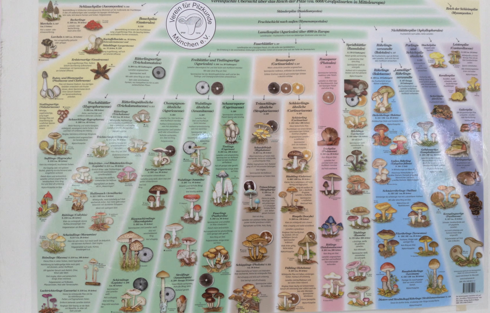

"Sopp er kanskje de organismene på jorda vi vet minst om. De er nærmere i slekt med dyr enn med planter."

Hva? Jeg ble allerede ordløs etter jeg leste første setning i den nye boken jeg kjøpte - Fungarium.

Jeg så en video på Youtube forrige uke om en sopp-utstilling i Tyskland. Sopp som tema i seg selv er fascinerende nok, men det som fascinerer meg mest er hva folk kan finne på, brenne for, nerde om...

[... kommer til å skrive mer]