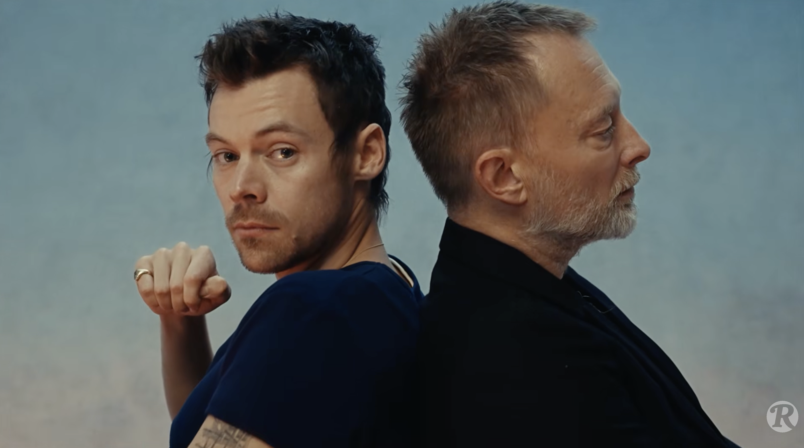
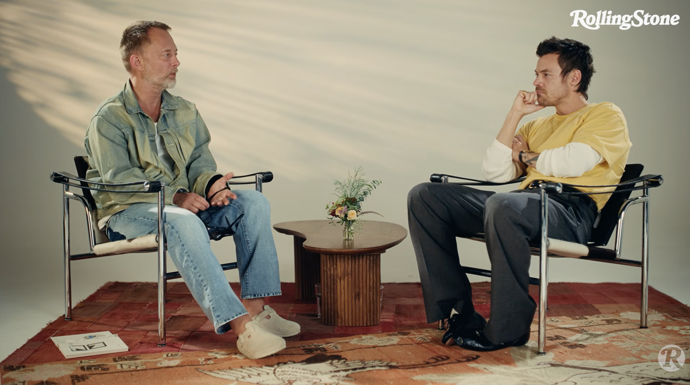

Det er lørdag. 

Det snør og regner ute. Ja, snø i oktober, faktisk. 

Da blir det innedag med en kopp god og varm te i hånden, og å være sofagris i dag og. 

Som en muskelreflex åpnet jeg Youtube og klikket på den første videoen som dukket opp i feeden. 

"Harry Styles & Thom Yorke | Musicians on Musicians."

Interessant. 

En times lang. Men en terapeutisk samtale om å være kreativ. Hmm, good stuff! Som i andre innlegg, her har jeg en oppsummering og høydepunkter. Så blir det sikkert litt alenetid med albumene til Harry og Thom etterpå. 🎧

<a class="raut-source-card" href="https://youtu.be/8N3PmjcvYtY?si=FKQK_c7HckBNuKqn" target="_blank" rel="noopener noreferrer">
  Samtale · Youtube · Harry Styles og Thom Yorke
  <strong class="raut-source-card__title">Musicians on musicians </strong>
  Samtalen mellom Harry Styles og Thom Yorke i Rolling Stones Musicians on Musicians .
  Se samtalen på Youtube ↗ (åpnes i ny fane)
</a>

---

## Oppsummering av videoen

I denne åpne og dype samtalen møtes to av musikkverdens mest innflytelsesrike artistikere på tvers generasjoner. De diskuterer hva det vil si å være kreativ, utfordringene ved å opprettholde kunstnerisk integritet i møte med enorm suksess og kommersielt press, og hvordan de faktisk skriver og produserer musikk (både alene og i band). Samtalen kretser mye om viktigheten av å "møte opp" til det kreative arbeidet, omgå imposter syndrom, og å bevare en søkende, barnlig nysgjerrighet i kunsten.

---

## Hovedperspektiver og høydepunkter

#### 1. Å være kreativ og gjøre kreativt arbeid

* **Gåing som kunstnerens perspektiv:** Begge snakker om hvordan det å gå gatelangs i byen (i øyehøyde i stedet for å kjøre bil) holder dem knyttet til den virkelige verden og menneskelige erfaringer.
* **Å møte opp og "surfing"-metaforen:** Kreativitet handler om å møte opp, selv når det føles tørt. Harry sammenligner det med å surfe: Du må øve og være klar til bølgen kommer, for ellers klarer du ikke å ri den når den plutselig dukker opp.
* **Imposter syndrom og perfeksjonisme:** Thom påpeker at skaperprosessen ofte innebærer lange perioder med tvil og imposter syndrom. Suksess bringer med seg et ytre støynivå som føles kunstig, og kunsten blir en måte å stenge støyen ute på for å grave i det ekte, "grumsete" menneskelige livet.
* **Beginner's mind:** De trekker frem prinsesippet om å beholde et "nybegynnerperspektiv" (beginner's mind) og ikke falle i fellen der du prøver å gjenta en tidligere suksess (å "arbeide på bestilling").

#### 2. Å skrive og jobbe med musikk

* **Låtskriving er naivt:** Thom påpeker at god låtskriving ikke kan være for utspekulert eller "savvy". De beste tingene bare skjer uten at man helt forstår hvorfor (som med Radioheads *Pyramid Song*).
* **Tekster og redigering:** Harry forteller om sin prosess med å overskrive tekster for deretter å koke dem ned til de tre versene eller ordene som treffer musikalsk best. Thom bruker ofte kasserte tekster i samarbeid med kunstneren Stanley Donwood for visuelle collager.
* **Stemmen som instrument:** Thom deler hvordan han etter *Kid A* begynte å behandle vokal som et instrument i seg selv (inspirert av Michael Stipe og folkemusikk), snarere enn bare en tradisjonell "gitar-og-sang"-fortelling.
* **Alene vs. i band:** Thom reflekterer over at det å jobbe alene går fort, men at det å ha et band eller produsenter (som Nigel Godrich) skaper en sunn friksjon som gjør at ideene filtreres og blir større enn summen av delene.

---

## Gode sitater og historier (med tidstempler)

* **Da de møttes for første gang i Roma:**
Harry forteller om da han så Thom på gaten i Roma iført en lue der det sto "acid", mens han hørte på *A Moon Shaped Pool* på øretelefonene:
[[00:22](https://www.youtube.com/watch?v=8N3PmjcvYtY&t=22)]
* **Da Thom skrev "A Wolf at the Door" under en tung periode:**
Thom forteller om kraften i å gå:
[[03:30](https://www.youtube.com/watch?v=8N3PmjcvYtY&t=210)]
* **Michael Stipes verdifulle råd om å gi slipp på frykten:**
Thom deler rådet han fikk fra REMs vokalist i Stockholm:
[[04:36](https://www.youtube.com/watch?v=8N3PmjcvYtY&t=276)]
> *"If you don't care, they don't care. If you're not looking, they're not looking."*

* **Om surfemetaforen for å fange ideer:**
Harry forklarer hvordan inspirasjon krever forberedelse:
[[13:36](https://www.youtube.com/watch?v=8N3PmjcvYtY&t=816)]
* **Viktigheten av nybegynnerens sinn:**
Thom refererer til Suzuki-boken om å starte med blanke ark:
[[57:22](https://www.youtube.com/watch?v=8N3PmjcvYtY&t=3442)]

---

Se hele samtalen her:

[https://youtu.be/8N3PmjcvYtY](https://youtu.be/8N3PmjcvYtY)
